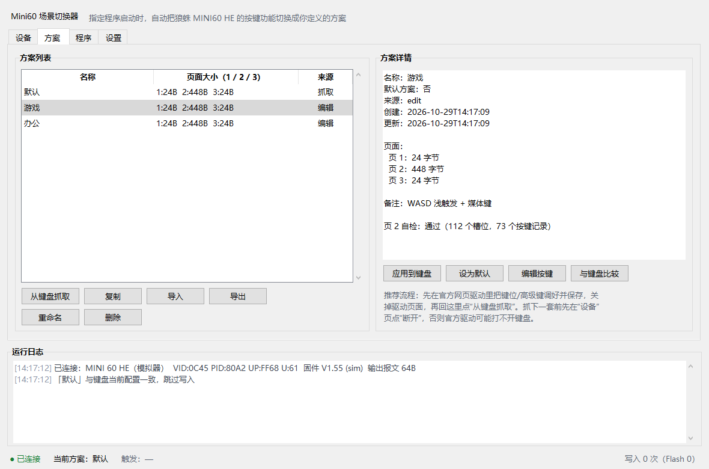
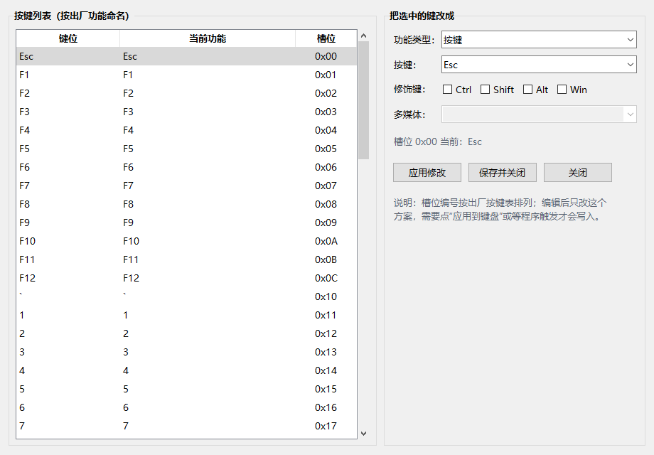

# Mini60 场景切换器

给 **狼蛛（AULA）MINI60 HE** 系列磁轴键盘用的小工具：**指定程序切到前台（激活）时，自动把键盘的按键功能切换成你定义的方案；切到别的程序后恢复默认方案。**

- 直接通过 USB HID 读写键盘配置页（不依赖官方网页驱动常驻）。
- 键盘功能可自定义：可以从官方驱动抓取整套配置，也可以在本程序里改单键（改键 / 多媒体 / 无输出 / 恢复出厂）。
- 程序规则可自定义：任意 exe、任意数量的方案；按当前前台程序匹配，列表顺序优先。
- 设置里可以直接写键盘的「无线休眠」时间（页 1 偏移 3，分钟）。
- 前台变化用系统 `SetWinEventHook` 即时唤醒，轮询只做兜底；切换时复用已读页做备份、按需清理 HID 输入队列，响应更快。
- 写入前自动备份、写入后读回校验、失败自动回滚。



---

## 1. 它到底改了什么

狼蛛 MINI60 HE 使用 SONiX **SN34F280** 主控，官方网页驱动（`hec.aulacn.com`）通过 64 字节 HID 报文读写键盘里的几个“配置页”：

| 页 | 内容 | 读命令 | 写命令 |
|----|------|--------|--------|
| 1 | 游戏模式 / 行程设置（休眠、回报率、RT 等，24 字节） | `0x11` | `0x21` |
| 2 | 按键自定义覆盖表（512 字节 / 128 槽位） | `0x12` | `0x22` |
| 3 | 灯效（24 字节） | `0x13` | `0x23` |

页 2 是**自定义覆盖表**：128 个 4 字节记录，全 0 表示该键使用出厂映射；有非 0 字节才覆盖。命令字 `0x12/0x22` 与 Aula Hub 客户端的 `GET_KEY/SET_KEY` 一致，有线每包 56 字节、2.4G 接收器每包 24 字节。

> 页 1 对应官方驱动的 `GET_GAME_MODE` / `SET_GAME_MODE` 配置块：偏移 3 是**无线休眠时间**（分钟，`0` = 从不），偏移 5 是回报率，偏移 11 是稳定模式等。「设置」页的「无线休眠」只改偏移 3，切换方案时其余整页内容照旧按快照写回。

报文格式：

```
偏移  含义
0     0xAA            电脑 -> 键盘的魔数
1     命令字          读 = 0x10 + 页号，写 = 0x20 + 页号
2     本包数据长度    有线最多 56，2.4G 接收器最多 24
3-4   页内地址（小端）
5     保留            0
6     结束标志        本页最后一个分片置 1（键盘提交并写入 Flash）
7     保留            0
8-63  载荷            最多 56 字节
32-63 补 0
```

键盘应答以 `0x55` 开头，结构相同，载荷同样从第 8 字节开始。

本程序就是：**读页 2（必要时连同页 1/3）→ 记住 → 触发时写回去**。因为写回去的是官方驱动自己写进键盘的原始数据，所以不依赖对“高级键”具体编码的猜测。

> 协议来源（公开逆向资料）：
> - [Unshackling the AULA Mini 60 HE Pro](https://thefriendlyghost.nl/aula-mini-60-he-pro)
> - [yxxbc/Mini60HeForMac](https://github.com/yxxbc/Mini60HeForMac)（SN34F280 页 1 / 页 3 报文）
> - [megablue/mini60he-max-reverse-engineering](https://github.com/megablue/mini60he-max-reverse-engineering)（固件按键表结构）

### 与 Mini60HeForMac 的对应关系

| macOS 版（Swift / IOKit） | 本程序（Win10 / Python） |
|---|---|
| `IOHIDManager` 匹配 `VID 0x0C45 + UsagePage 0xFF68` | `SetupAPI + hid.dll` 枚举，匹配 `VID 0x0C45 + UsagePage 0xFF68 / 0xFF60` |
| `IOHIDDeviceSetReport(..., reportId: 0, 64B)` | `WriteFile` 64 字节 output report（65 字节时自动补 reportId 0） |
| `PID 0x80A2`（有线）/ `0xFEFE`（2.4G） | 默认同时识别 `0x80A2 / 0xFEFE / 0x80A1`，按产品名/UsagePage 排序 |
| `queryLightingState()` → `0x13` | 读页 3（`0x13`） |
| `setLighting()` → `0x23` | 写页 3（`0x23`） |
| `setActuationAndRT()` → `0x21` | 写页 1（`0x21`） |
| 无（macOS 版不做改键） | 新增页 2 读写（`0x12 / 0x22`）+ 方案切换 |

也就是说：**灯效、触发行程、RT 这些 macOS 版能做的，本程序都能通过“抓取整套配置”一起保存和切换；另外补上了键位/高级键页和“按程序自动切换”。**

> 真机验证（2026-10-29，MINI 60 HE PRO 有线 `0x80A2 / 0xFF68`）：设备枚举、页 1/2/3 读取、页 2 单键写入 → 读回 → 关闭重开仍保留 → 恢复全 0，全部通过。2.4G 接收器 `0xFEFE / 0xFF60` 已按 33 字节报文、24 字节分片适配，但未在活跃无线模式下验证。

---

## 2. 运行

### 方式 A：免安装 exe（推荐，不需要 Python）

```
dist\Mini60Pilot\Mini60Pilot.exe
```

双击即可；配置、备份和日志会生成在 exe 同目录的 `data\` 里，整个 `Mini60Pilot` 文件夹可以拷到别的 Win10 机器直接用。

### 方式 B：源码运行

要求：Windows 10/11，Python 3.10+（安装时勾选 **Add Python to PATH**，自带 tkinter）。

```bat
:: 双击
启动.bat

:: 或者带控制台启动，方便看报错
python run.py

:: 没有键盘也可以先体验
python run.py --simulator
```

首次启动会自动连接键盘；没有键盘时可以勾选「使用模拟器」把整套流程跑一遍。

### 托盘与开机静默启动

- 点窗口右上角关闭：**不退出**，隐藏到右下角系统托盘；双击托盘图标重新打开，右键菜单可退出。
- 设置页勾选「开机自动启动（静默到托盘）」：写入 `HKCU\...\Run`，命令带 `--silent`，登录后不弹主窗口，直接进托盘。
- 重复启动只会唤起已有实例，不会开第二份（单实例互斥量）。
- 如果系统没有 Explorer 托盘（或托盘接口不可用），程序会退化为正常窗口 / 关闭即退出，避免“窗口没了又找不到图标”。

---

## 3. 五分钟上手

1. 键盘用**数据线直连**。
2. 先打开官方网页驱动，把一套键位（以及要用到的“高级键”）调好并保存到键盘，然后**关闭驱动页面**（官方驱动会占用厂商接口）。
3. 打开本程序，在「设备」页点「刷新设备」→「连接」。
4. 「方案」页点「从键盘抓取」，命名，例如 `默认`。
5. 想做第二套：回到「设备」页点「断开」→ 打开官方驱动调好另一套并保存 → 关闭驱动 → 回本程序点「连接」→ 再「从键盘抓取」，命名 `游戏`。
6. 「程序」页点「添加程序…」，选择 `cs2.exe`，方案选 `游戏`。不确定进程名时，先打开目标程序，再点「识别前台程序」自动填入。
7. 完成。目标程序切到前台 → 自动切到「游戏」；切到别的窗口 → 自动恢复默认方案。规则支持 `*`/`?` 通配符（例如模拟器游戏用 `aow_*.exe`）。

建议第一次先勾选「仅演练，不写键盘」，看日志确认规则触发正确，再取消勾选实际写入。

### 无线休眠

「设置」页的「无线休眠」会写进键盘页 1 的偏移 3（官方驱动 `GET_GAME_MODE` / `SET_GAME_MODE` 配置块），单位为分钟：

- 可选值与官方 Aula Hub 的「休眠设置」一致：从不 / 1 / 2 / 3 / 5 / 10 / 15 / 20 / 25 / 30 / 45 / 60 / 120 分钟，`0` = 从不休眠。
- 保存设置时会立即尝试写入键盘；键盘没连接就等下次连接时写入。
- 切换方案时会保留这个值，不会被抓取方案里的旧休眠时间覆盖。
- 选「不修改（保持键盘当前设置）」时不会主动改这个字节；但如果方案包含页 1，应用方案时仍会按方案快照写回页 1（包括抓取到时的休眠时间）。

### 不用官方驱动也能改键



「方案」→ 选中方案 →「编辑按键」：

- 按出厂功能列出的键位表，选中一个键，改成「按键 / 多媒体 / 无输出 / 恢复出厂」。
- 支持修饰键组合（Ctrl / Shift / Alt / Win）。
- 保存后只改方案，点「应用到键盘」或等规则触发才会写进键盘。

按键编辑有保护：页 2 数据必须先通过结构自检（128 个 4 字节记录）才会开放；识别不了就只用「从键盘抓取」的快照方案，避免写坏。页 2 是“自定义覆盖表”，全 0 表示全部使用出厂映射，所以刚抓下来的默认方案会显示 0 个自定义键——这是正常的，去官方驱动改键后再抓取即可。

**做不到的**：宏、鼠标功能、单击/长按双用等“高级键”的编码没有公开，本程序不会凭空生成；这类配置请在官方驱动里调好后抓取成方案。程序会原样保留这些记录。

---

## 4. 安全机制

- **写入前备份**：每次实际写入前，把当前页 1/2/3 原样存到 `data/backups/`（保留最近 40 份）。
- **读回校验**：写完逐页读回比对，不一致就报错。
- **失败回滚**：任何一页写入/校验失败，自动把已经写过的页面恢复成写入前的内容。
- **内容相同不写**：方案与键盘当前配置一致时跳过，减少 Flash 擦写。
- **快速响应**：前台窗口变化由 `SetWinEventHook` 立即唤醒（实测 Notepad 切前台到写完约 0.1s）；2.4G 下页 2 读取由 0.69s 降到 0.24s，切换不再重复读一遍做备份。
- **演练模式**：只打日志不写键盘。
- **读取诊断**：「设备」页可以读取当前页 1/2/3 的大小、摘要与页 2 自检结果，便于确认真机协议。
- **激活匹配检查**：「程序」页可以查看当前前台（激活）程序的真实 exe/标题，以及每条规则当前是否命中。
- **手动备份/恢复**：「设备」页随时可以整盘备份或恢复历史备份。

> 注意：配置页写在键盘 Flash 里，频繁切换会有擦写寿命（通常几万次量级）。本程序已经做了“内容相同不写”，日常按程序切换没有问题，但不建议把兜底轮询间隔调得极小、让规则反复触发。

---

## 5. 目录与数据

```
mini60-pilot/
├─ run.pyw / run.py         启动入口
├─ 启动.bat                 双击启动（无控制台）
├─ mini60pilot/
│  ├─ protocol.py           64 字节报文 / 分片 / 应答解析
│  ├─ codec.py              页 2 的 4 字节按键记录编解码
│  ├─ keycodes.py           HID 键值表
│  ├─ config.py             方案 / 规则 / 设置 / 备份
│  ├─ watcher.py            前台窗口 / 进程监听（WinEvent + User32 + Toolhelp32）
│  ├─ engine.py             规则引擎、读写、校验、回滚
│  ├─ device/
│  │  ├─ hidwin.py          Windows HID（SetupAPI + hid.dll，纯 ctypes）
│  │  └─ simulator.py       内存模拟键盘
│  └─ ui.py                 Tkinter 界面
├─ tests/                   单元测试 + 模拟器端到端
└─ data/                    运行后生成：config.json、backups/、app.log
```

`data/` 可以整个拷走；换机器时把文件夹一起带走即可。

### 设备匹配参数

默认：`VID=0x0C45`、`Usage Page=0xFF68`、`Usage=0x0061`，有线 PID `0x80A2`（无线接收器可能是 `0xFEFE`）。

不同批次 / Mini60 Pro / Max 的 PID 可能不同。识别不到时在「设置」页把 **PID 留空**，只按 VID + Usage Page 匹配；仍不行就填官方驱动里看到的 VID/PID。

---

## 6. 常见问题

**Q：提示“没有找到狼蛛 MINI60 HE”。**
- 确认是数据线直连，不是蓝牙/2.4G（无线接收器 PID 不同，可把 PID 留空）。
- 关掉官方网页驱动标签页、桌面驱动、其他改键软件（它们可能独占厂商接口）。
- 点「刷新设备」；仍不行就在「设置」里把 PID 留空再试。

**Q：连接/写入报“拒绝访问”或“打开键盘失败”。**
- 用普通用户运行即可，不需要管理员；被占用时先退出官方驱动。
- 少数安全软件会拦截对 HID 的写入，临时放行本程序。

**Q：程序启动了，但“触发”一直是“—”，或者切走后没恢复？**
- 规则只认**当前前台（激活）**的程序：程序在后台跑着不会触发，切到它的窗口才会切换；切到别的窗口会恢复默认方案（可在设置里关闭）。
- 在「程序」页点「查看激活匹配」，看当前前台 exe 和规则是否命中；模拟器/启动器经常和游戏主进程不是同一个名字（例如启动器是 `wgprojectm.exe`，游戏切到前台后可能是 `aow_exe.exe`），两种都要各加一条规则。
- 切到目标程序窗口，点「识别前台程序」，它会读取真实前台 exe 并直接建规则；也可以手写通配符 `aow_*.exe`。
- 确认规则是“启用”状态，且方案没有被删除。

**Q：抓取成功，但切换后键位没变。**
- 看日志里“改动页”是否为 `[]`（内容相同会跳过）。
- 确认规则里的 exe 名和任务管理器里的进程名一致（例如 `cs2.exe`）。
- 确认没有勾选「仅演练」。
- 前台切换是即时触发的；如果键盘没变，先看日志里有没有真的写入（2.4G 下页 2 整页写入本身约 0.65s）。

**Q：切到目标程序后，键盘要过一会儿才变？**
- 前台变化现在由系统事件即时触发（实测切到 Notepad 后约 0.1s 写完单页）；剩下时间主要花在写键盘和读回校验上。
- 2.4G 接收器下，页 2（512 字节、22 个分片）整页写入约 0.65s、读回校验约 0.24s，一次完整切换约 1s；有线会明显更快。
- 想更快可以在设置里关掉「写入后读回校验」（不推荐），或让方案只包含真正需要切换的页。

**Q：页 2 自检不通过，不能编辑按键。**
- 说明这个固件/批次的页 2 结构与已知资料不同；不影响「抓取 / 切换」，只是不能用内置编辑器，请继续用官方驱动改键后抓取。

**Q：怎么完全卸载？**
- 取消「开机自动启动」，删除整个文件夹即可；键盘里的配置可以用「设备」页的备份恢复，或在官方驱动里恢复出厂。

---

## 7. 开发与测试

```bat
python -m unittest discover -s tests -t . -v
```

54 个测试覆盖：报文布局、应答解析、页 2 编解码、配置存取、前台激活监听（含事件唤醒）、规则通配符、无线休眠写入、自启命令、模拟器端到端切换/恢复/回滚。

没有硬件时可以用模拟器跑完整流程：

```bat
python run.py --simulator
```

模拟器里默认页 2 是一张 128 槽位的按键表，改键、抓取、规则切换、备份恢复都能走通。

### 打包成免安装 exe

仓库已附带 `dist\Mini60Pilot-win10-x64.zip`（解压后双击 `Mini60Pilot.exe`，Win10 x64 无需装 Python）。

重新打包：

```bat
python -m pip install pyinstaller
python -m PyInstaller --noconfirm --onedir --console --name Mini60Pilot ^
  --icon assets\app.ico --add-data "assets;assets" run.py
```

- 用 `--console` 是为了出错时能看到信息；程序启动后会自己隐藏控制台（`GetConsoleProcessList` 判断不是从 cmd 启动才隐藏）。
- `assets/app.ico` 是托盘/窗口图标，`--add-data` 让它在打包后仍能被 `sys._MEIPASS` 找到。
- 想保留控制台调试：设置环境变量 `MINI60_CONSOLE=1` 再运行。
- 打包后可用 `Mini60Pilot.exe --selftest` 做无界面自检，`--simulator --smoke` 做界面冒烟测试。

---

## 8. 已知限制

- 本工具按**官方网页驱动 / 社区逆向的 0xAA 页协议**实现。官方 Aula Hub 桌面端对部分型号还使用另一套 63 字节命令集；如果「读取诊断信息」读到的页数据明显不合理（全 0、长度异常、反复超时），说明你的固件走的是另一套协议，**先不要写入**，把诊断结果发回来再适配。
- 页 2 的 4 字节记录格式用于「单键改键 / 多媒体」的编辑；宏、鼠标、配置切换等高级动作只做**原样保留和整页同步**，不会在程序里凭空生成。
- 默认只读写页 1（行程/RT）、页 2（按键功能）、页 3（灯效）。如果某个固件把宏定义放在页 4 之后，这些内容不会随方案切换；页 2 里「哪个键触发宏」的绑定仍会切换。
- 抓取时如果某一页读不到（例如页 2 命令不兼容），程序会跳过该页并继续保存其它页；这样至少还能切换灯效/触发行程。日志里会列出跳过的页。
- 页 1 里的行程 / RT / 回报率等设置会和方案一起切换；「设置」里的「无线休眠」会单独保留。如果你只想切键位，可以在「设置」里取消“包含页 1”。
- 激活检测只看**前台窗口**：程序在后台不会触发；启动器和游戏主进程名字不同时，要给两个 exe 各建一条规则。
- 2.4G 接收器下写页 2 受键盘 Flash 速度限制，整页约 0.65s；有线的分片更大、会快很多。前台检测本身已经事件化，不是瓶颈。
- 「无线休眠」写的是页 1 偏移 3（官方 `SET_GAME_MODE` 的 `sleepTime`）。不同固件/型号偏移可能不同，写入前建议先做好备份。
- 协议来自公开逆向资料，未经官方支持；不同批次 / Pro / Max 的 PID、页长度可能不同，先用「读取诊断信息」确认。

---

## 9. 免责声明

本项目是非官方工具，协议来自公开逆向资料，未获得狼蛛官方支持。写键盘配置有风险（尤其是断电/拔线导致写入中断），请先备份、先演练。因使用本工具造成的键盘配置丢失或损坏，需自行承担。
